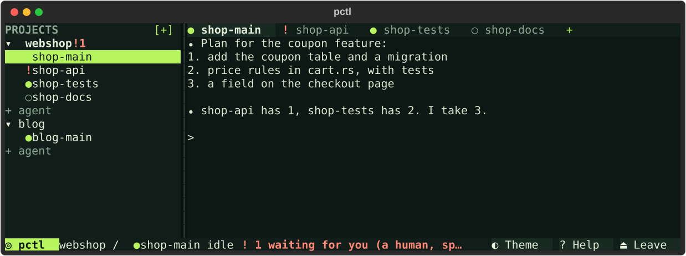
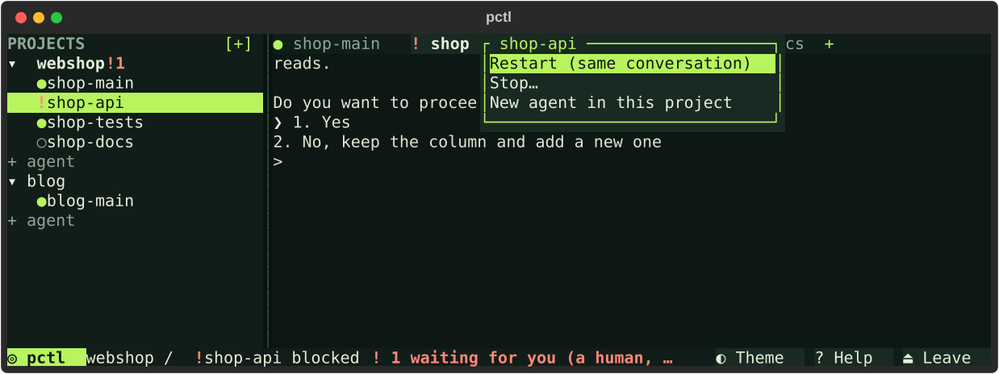
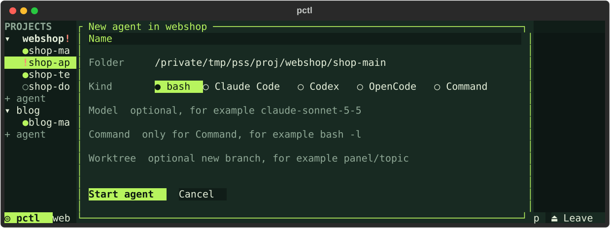
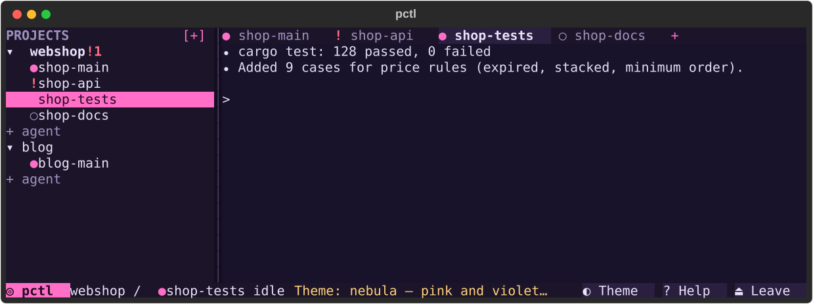

# pctl

A tmux-based control plane for interactive coding-agent sessions (Claude Code, Codex). One tmux server per state directory. Sessions are addressed by name and can be listed, read, prompted, waited on, restarted on the same conversation, and restored after a reboot. Agents send each other messages through it.

- Origin: the PCTL 0.6.0 prototype by Pikk (MIT, "pctl prototype contributors"). This repository adds a macOS port, `--host`, msg wake-ups, and the `pctl session` commands.
- `CLI.md` is the command and JSON contract. `SKILL.md` is the agent-facing guide. Both are compiled into the binary, so keep them accurate.
- Private and under active development. It is not a sandbox: the state directory is trusted local state.

## Build

Requirements: Rust 1.99+ (edition 2024), tmux 3.8+, and Python 3 for the integration suites. Older versions are not tested. Runs on macOS arm64 and Linux.

```sh
cargo build --release --locked
```

## Test

```sh
cargo test --release --locked
cargo clippy --release --locked --all-targets -- -D warnings
```

The real-tmux suites start their own servers in temporary state directories. Each takes `--bin`, `--tmux` and `--report`, except `remote_quoting.py`, which takes only `--bin`:

```sh
B=target/release/pctl T=$(command -v tmux); mkdir -p test-results
for s in integration collaboration_integration msg_workflow_integration orchestration_integration \
         session_integration sidebar_integration sidebar_recovery snapshot_batch_integration \
         team_context_preflight tmux_encoding_integration wake_integration web_integration worktree_integration human_entry app_integration; do
  python3 tests/$s.py --bin $B --tmux $T --report test-results/$s.json >test-results/$s.out 2>&1; echo "$s exit $?"
done
python3 tests/remote_quoting.py --bin $B; echo "remote_quoting exit $?"
```

## The app

Type `pctl` in a terminal. The pctl app opens straight onto your agents:



- **Left:** projects and their agents with their state.
  - `●` idle (green) or working (blue)
  - `!` waits for you
  - `×` exited, `○` stopped
- **Top:** the project's tabs.
- **Middle:** the selected agent's live terminal. Typing goes to it, and the wheel scrolls back.

Everything works with the mouse:



| To do this | Click |
|---|---|
| Open an agent | the agent or its tab |
| Open a bash terminal | `+` in the tab bar |
| Start Claude Code, Codex, OpenCode or a command | `+ agent` (a form; bash is preselected) |
| Add a project | `[+]` next to PROJECTS |
| Restart (same conversation), stop, start or remove an agent | right-click or double-click it (or `ctrl+b m`); stop and remove ask first |
| Resize the sidebar | drag its edge |
| See the shortcuts | `? Help` |
| Leave | `⏏ Leave` (the agents keep running) |



Shortcuts: press `ctrl+b`, then:
- `c`: new bash tab
- `a`: new agent
- `m`: the agent's menu
- `n` / `p`: next / previous tab
- `1`…`9`: go to that tab
- `x`: stop
- `r`: restart
- `t`: theme
- `b`: sidebar
- `w`: keyboard sidebar
- `?`: help
- `q`: leave

Change them in `~/.config/pctl/config.toml` (or under `$XDG_CONFIG_HOME`):

```toml
[keys]
prefix = "ctrl+a"
next_tab = "alt+right"   # a key without the prefix
new_agent = "prefix+g"
```

Themes: `◐ Theme` (or `ctrl+b t`) picks one of the built-in themes:
- `portal` (green), `garage` (amber), `nebula` (violet), `void` (deep blue)
- `lab` (light)
- `classic` (your terminal's own colours), `mono`

The terminal area follows the chosen theme too.



Make your own: `pctl theme --new mine --from garage` writes `~/.config/pctl/themes/mine.toml`, with every colour and a comment saying where it shows. Change the colours and pick `mine` from `◐ Theme`. `pctl theme --list` shows all themes and any problems in your files. Agents can make themes the same way. Keep your own themes in your own config folder; do not commit them here.

A little dry humour shows up where nothing is at stake: loading, empty screens, tips, goodbye. It never appears in errors or anything agents read. `[ui]` with `wit = false` in the config file turns it off.

`pctl` reopens on the project and tab you left. It never starts a server by itself; adding the first agent follows the same rule as `session add` (see [Starting the server](#starting-the-server)). tmux still keeps the processes behind the app. `pctl attach [--project <name>]` opens a plain tmux client instead.

## Starting the server

pctl starts its tmux server only when the caller may. Usually that means setting `PCTL_STANDALONE=1`.

On macOS, permissions such as Full Disk Access, Accessibility and Screen Recording follow the process that starts the server. If one terminal app carries them, let only its panes start the server. Name the variable that app sets to `1` in its panes:

```toml
# ~/.config/pctl/config.toml
[server]
start_env = "TERMAPP_ENV"
```

Variables with the same prefix (`TERMAPP_` here) are not copied into agent panes. A refused start fails with `server_start_not_allowed` and creates nothing.

## Web page

`pctl web --listen <tailscale-ip>:<port> --token-file <0600 file>` serves a phone page to list sessions, read one screen and type a line. It refuses other addresses, needs the token for every API call and refuses input to blocked sessions. See CLI.md.

## Worktree workers

`pctl session add --name <name> --cwd <repo> --worktree <branch> [--base <ref>] [--model <provider/model>] -- <argv>` creates the branch, makes the worktree `<repo>-wt-<name>` and runs the session there. `--model` sets an OpenCode session's model. `pctl worktree list` shows each worktree's branch, base, dirty files, commits ahead and whether it is merged. `pctl worktree remove <name>` moves a stopped, clean, merged worktree to the trash, deletes the merged branch and unregisters the session. It refuses anything else. See CLI.md.

## Lite package

`scripts/package-lite.sh [target]` builds `dist/pctl-lite-<version>-<target>.zip` for offline install. The ZIP contains:
- a static binary
- `install.sh` (copies the binary, no network)
- `QUICKSTART.md` and `pctl.env.example`
- `smoke.sh` (the same file as `scripts/lite-smoke.sh`)
- licenses, `BUILDINFO.txt` and `SHA256SUMS`

The default target is `x86_64-unknown-linux-musl`. It links with the toolchain's `rust-lld` and needs `rustup target add x86_64-unknown-linux-musl`.

`scripts/lite-smoke.sh target/release/pctl` runs the offline smoke test: two fake agents, session control, messages, duplicate and blocked refusals, and restart.

## Workflow

1. Every change starts from an issue that says what to change, when it is done, and how to test it.
2. Branch `<who>/<issue>-<slug>` from `main` and keep the change small.
3. Open a PR that links the issue and pastes the exact commands and results: unit tests, clippy, and the suites the change touches.
4. The maintainer re-runs the tests and merges. There is no CI and no auto-merge.
5. Contributors without repository access send `git format-patch` output against a named `main` commit. The maintainer applies it on a branch and opens the PR.

Do not commit secrets, tokens, host names, personal paths, or logs. Tests must use temporary state, never a real `~/.local/state/pctl`.
